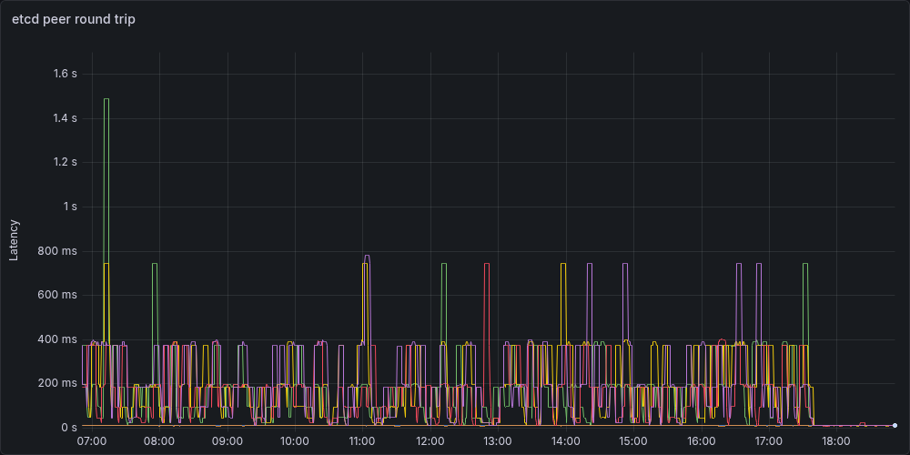

I have a thesis: sometimes I do smart things, other times I do dumb things. I learned a lot with this little experiment, but it's firmly in the dumb things category.

For as many services as I can, I've replaced cloud services with local variants. I don't like most SaaS providers, and most importantly, I don't trust most SaaS providers. Everything I run locally is on a ten node Kubernetes cluster.

A lot of what I run is "infrastructure" but there's enough that are services that I want access to regardless of where I am. The simple solution to this is a WireGuard server on my router that allows access to the virtual IP (VIPs) of a load balancer in Kubernetes land. This works perfectly for me, however the one thing that currently isn't possible is public access. I'd like to host personal stuff (for example; this site) and have it be publicly addressable. If I was smart, I'd just use GitHub Pages and call it a day, or I could do the same thing I do with WireGuard except port forward an open port to an "external" VIP. But where's the fun in that? What if instead, I added a remote node in a cloud provider and used their network offerings to funnel traffic into the cluster.

In order to do that there's a few problems to tackle and a few requirements to get out of the way
1. The remote node needs to connect back to the bare metal nodes
1. Traffic between my bare metal nodes and the cloud nodes need to be encrypted (it goes over the public internet)
1. This needs to be really cheap
1. The kubelet and Talos API server cannot be publicly addressable

# Step 1: Connecting the Cluster to My Tailnet

> [!note]
> Since my cluster is backed by [Talos Linux](https://www.talos.dev) I could have used Kubespan (Talos' public WireGuard discovery service to create a mesh network), this would have been the smarter thing to do and saved me a _lot_ of headache

In order to connect the remote nodes to my local nodes and hit just about every requirement in the list. I need an encrypted overlay network, WireGuard is the obvious choice - but it's also a PITA to configure for 11 nodes. [Tailscale](https://tailscale.com) is a really great way to do this easily (not an ad, I don't even pay for it. It's just a really great service). At the end of the day it's just WireGuard but they handle the annoyance of distributing all public keys to all nodes.

Since Talos is an immutable operating system there's no way to just "install" Tailscale. Thankfully someone already did the hard work of setting up a system extension to run Tailscale. All it needs is a basic config to authenticate with the Tailscale control plane

```yaml
apiVersion: v1alpha1
kind: ExtensionServiceConfig
name: tailscale
environment:
  - TS_AUTHKEY=${TS_AUTHKEY}
```

While I'm not convinced it's necessary I also added a patch for the machine configuration to force kubelet to bind on the tailscale0 interface

```yaml
machine:
  kubelet:
    nodeIP:
      validSubnets:
        - 100.64.0.0/10 # <- Tailscale IPs are picked from this CIDR
```

## A Brief Aside on My Infinite Shame

I don't know why I do it - but when mucking around with the cluster I experiment on my control plane nodes. I have three of them. If I bork one, the other two still have quorum, I can blow away the borked node and all is right in the world. So this is the approach I took. I first upgraded `cp3` (control plane 3) it took the new machine image without any issue. I upgraded the node to the new machine image, crossed my fingers and rebooted `cp3`. On reboot it connected to Tailscale and every thing seemed good. So the next logical step is to upgrade `cp2` by doing the same thing. Apply the machine image, upgrade, reboot, and... nothing. `cp2` wouldn't boot the new machine image. Checking the extensions in Talos and the `ext-tailscale` extension wasn't even loaded, something went wrong. So I do what I always do, hard reset the machine and reapply.

Except this time that strategy failed. Something was borked and the node was stuck in `booting` which means the API server won't accept system commands. "No problem" I told myself, I'll upgrade `cp1` and reset `cp2` off a flash drive later. For the sake of capturing my shame let's keep a side count here. I have one node on the Tailscale network, one dead control plane node and a third functioning control plane node that isn't on the tailnet.

So I then go to roll `cp1` so I can at least have quorum established over the tailnet. I apply the machine configuration, do the upgrade... and it wont take the machine config. So let's try the hard reset again, and... stuck in booting. Keeping track of the shame counter: there's one node on the tailnet and two dead nodes. At this point I panic and realize that this is beyond salvaging, I need to restore `cp3` to a non-Tailscale version, restore the other two nodes and start fresh and figure out what's going on

I do that, I apply the old machine configuration with the old machine image, and it goes badly. So now I say to myself, screw this I'm wiping `cp3` and starting from scratch. So I do that. Talos at this point warns me that I won't have quorum, "this is fine" I tell myself, I'll reapply the machine config after wiping the node and everything will be fine. Did you catch that? The shame counter is now at two dead nodes and I just wiped the third. This leaves me with _exactly_ zero (0, 0.0, zilch, no) available copies of etcd, I have no API servers so I cannot access any workloads. The entire cluster is dead. Way to go Aaron.

While I don't bother backing up etcd, I have daily Velero backups of all resources and volume backups. So not all is lost just a very tedious disaster-recovery exercise, and all that really gets lost is the cluster CA, not a big loss at the end of the day (or several days of disaster recovery). What lessons could be learned from this? Don't be dumb, back up etcd, and don't be a moron and panic wipe your entire control plane. It shouldn't need to be said, but apparently I needed to hear it.

## Talos, Tailscale, and DNS
After fully recovering (since the cluster was completely reconstructed I took the liberty of creating nodes from the get-go with Tailscale installed). I wanted the control plane accessible over the tailnet. Tailscale's magicDNS should magically map `cp1` to its internal tailnet address (spoiler `dig kube.shifman.dev` will tell you exactly where this is going). I was never able to get this to work and I have a suspicion as to why.

If I configure the DNS to use `100.100.100.100` as the resolver, when the machine boots there's no way to resolve `controlplane.tailscale.net` so the node is never able to join the tailnet. Alternatively, if I add two DNS addresses; magicDNS and say Cloudflare (`1.1.1.1`) at boot; Talos realizes that magicDNS is dead and marks it so - and only uses Cloudflare. So I've added public DNS records for the tailnet addresses of the control plane nodes - they're static(ish), of my list of problems this is the smallest.

This is one limitation of Talos, if I need to debug anything at the operating system level, or at least "sub-Kubernetes" level problems I'm very limited in what's possible to investigate. As a result, sometimes trickery like placing a tailnet IP on a public DNS record is necessary.

# Step 2: Remote Nodes
Now that I have all existing nodes connected over Tailscale (and a brief detour into a disaster recovery drill) now it's time to add a new remote node. I wanted a cheap cloud provider since this is essentially a toy. Hetzner has dirt cheap compute (€3.49/mo) and a decent Terraform provider so it's a fairly simple call. The downside is that they heavily favor their European data centers (I'm in Canada - but how bad could it be to connect halfway across the globe between the control plane and remote nodes?)

I want the remote node to be in a "VPC" of sorts, even though the Talos API server is mTLS why expose it if you don't have to. So since Hetzner is a bit "simple" in terms of their offering let's just build a quick and dirty VPC.

The new worker node is assigned _only_ a private IP address. For context, the VPC uses the `10.0.0.0/16` CIDR range. Since it only has a private IP address it has no egress route to the public internet. So the next thing to build is a "NAT-gateway". The purpose of this is to act as a router and NAT all incoming traffic from the VPC onto the public internet. This gives all nodes egress access to the public internet without exposing them directly. And the NAT gateway has no ingress (except for SSH ingress limited to my home public IP for security). Once the nodes leverage the gateway for their egress to connect to Tailscale, I can leverage the tailnet overlay to get direct access to the Talos API server for configuration.

The end result is something like this



flowchart TB
Internet((Public Internet))

subgraph VPC1["On-Prem VPC"]
    direction TB
    CP1["control-plane-1"]
    CP2["control-plane-2"]
    CP3["control-plane-3"]
    WN["worker nodes"]
end

subgraph VPC2["Hetzner VPC"]
    direction TB
    HW["worker"]
    NAT["NAT Gateway"]
end

TS["Tailscale Mesh Network"]

Internet --- NAT
NAT --- HW

CP1 --- TS
CP2 --- TS
CP3 --- TS
WN --- TS
HW --- TS


On the Talos side it's fairly straight forward to set this up. Just route all traffic to the VPC gateway (`10.0.0.1`), on the Hetzner side there's a routing rule for all VPC traffic to forward to the NAT gateway
```yaml
networkInterfaces:
  - interface: tailscale0
    routes:
      - network: 100.64.0.0/10
  - interface: eth0
    dhcp: true
    routes:
      - network: 0.0.0.0/0
        gateway: 10.0.0.1
      - network: 10.0.0.1/32
```

I won't describe the Hetzner stuff in detail they do a really good job of describing the [steps](https://community.hetzner.com/tutorials/how-to-set-up-nat-for-cloud-networks). The important addition is that since the Talos control plane is private now I won't be able to apply the machine configuration to give it the Tailscale configuration. So the first time the machine gets configured, the NAT gateway gets leveraged as a jump host. SSH is used to tunnel from the NAT gateway which is on both the private and public internet - to the awaiting Talos node (`ssh -L 50000:talos-node:50000 nat-gateway`). This way no keys ever leave my machine and once it has the Tailscale config it can be hit at the Tailscale IP.

# Step 3: Public Access
The last step to get this working is funneling traffic from the public internet into the cluster. Which should be straight forward. Create a load balancer and make sure it's attached to the VPC, point the load balancer at the nodes, and done.


flowchart LR
Internet((Public Internet))

subgraph VPC["VPC"]
    direction TB
    W1["Worker Node"]
    W2["Worker Node"]
end

LB["Load Balancer"]

Internet --- LB
LB --- W1
LB --- W2


The way this is normally done is to create the load balancer via a Kubernetes load balancer service
```yaml
apiVersion: v1
kind: Service
metadata:
    name: loadbalancer
spec:
    type: LoadBalancer
    selector:
        foo: bar
    ports:
        - name: http
          port: 8080
          targetPort: 8080
          protocol: TCP
```

Normally (in say GKE or EKS) your cloud controller will take over and provision and configure the necessary resources to make this work. Being an unmanaged cluster there is no cloud controller. Luckily Hetzner has one and it's simple to install as a helm chart. So I install it, and all of a sudden I start having problems, nodes start disappearing, i.e. `kubectl get no` has less than 11 nodes, not some nodes are unavailable or unhealthy, but removed from the cluster.

My best guess as to what's going on is that the cloud controller wasn't able to address the on-prem nodes. As we'll come to see in the next section, there was connectivity issues despite the cluster being connected over Tailscale. When the cloud controller figured the nodes weren't addressable ("probably dead") it evicted the nodes from the cluster.

A Kubernetes load balancer service is really just a port forward along with some controller to provision an external IP and route traffic to that port. Well... I can do that manually, if I add a node port service with a fixed port, and manually provision the LB and point to that port on all cloud nodes. That just means I am the cloud controller now. To my surprise that actually worked, until the cluster started dying

# Epilogue: Instability
My remote node is in Helsinki, I'm in Canada. The usual guidance is that control plane nodes _must_ have a super quick and direct connection since etcd is based on raft, every write requires a successful replication from a majority of nodes to move on. That's fine, all 3 of my control plane nodes are beside one-another in the server rack, the connection between the remote kubelet and the control plane will be slow. Since the workloads should change very infrequently on the remote node, this _shouldn't_ be a problem

So I hook up the remote node to the cluster, a few pods start scheduling on the remote node and things look... mostly good. Logs take a long time to load (streaming text from Helsinki to Canada won't be fast), dropping into a shell (`kubectl exec`) is dog-slow but it works. But after about 10-15 minutes, I start noticing something strange. Just loading cluster information (`kubectl get no`) starts taking a long time, or connections to the control plane start dropping.

Eventually I see the state of the `hetzner-1` node is `Not Ready`. This makes sense, my ping to Helsinki is ~300 milliseconds, if the kubelet misses even a single heartbeat cycle, it doesn't take long before the node gets marked `Not Ready`. Just so, in the event log every few minutes I get to see on all nodes (not just the remote node)

```
 Node some-node event: Registered Node some-node in Controller
```

Which is strange, something about adding a flaky node that's flapping is causing all other nodes to flap, including the control plane nodes. Which means etcd leader elections are occurring constantly, which also means the Talos VIP for the control plane is constantly getting reassigned.

My working theory, and admittedly it's a bit flaky is that. Every time a node creates a direct connection it causes other nodes in the tailnet to recompute/reestablish their connections. If there's a flaky connection (i.e. transiting the Atlantic every 1000 milliseconds to heartbeat) other nodes are also going to re-sync with the tailnet. It makes a degree of sense in my head, but in the future I want to play with Tailscale connections directly (removing Kubernetes from the picture to validate this idea)

## Violating Cheapness

In order to partly validate the theory about flaky connections I move the VPC, LB and servers from Helsinki to Ashburn VA (ping time drops to ~30 milliseconds). I remove the old node from the cluster and rejoin the new machine to the cluster. Unfortunately Hetzner does favor their European data centers. US data centers don't have access to the super cheap nodes sadly, still cheap just not _as_ cheap (€9.49)

Price notwithstanding; lo-and-behold no more node flapping. Things look good for the most part, but I still notice transient delays in connecting to the cluster, especially over the VIP. I also re-enable pages from PagerDuty (since while everything is on fire it's pretty redundant to be told: "hey things are borked"). Amongst the pages I notice a few interesting Prometheus alerts

```
etcdHighNumberOfLeaderChanges
etcdMemberCommunicationSlow
```

Checking the Talos logs of the control plane nodes also shows

```
user: warning: [talos] campaign failure {"component": "controller-runtime", "controller": "network.OperatorSpecController", "operator": "vip", "error": "failed to conduct campaign:
 etcdserver: mvcc: required revision has been compacted", "link": "enp1s0", "ip": "192.168.2.2"}
user: warning: [talos] service[etcd](Running): Health check successful
user: warning: [talos] service[etcd](Running): Health check failed: context deadline exceeded
user: warning: [talos] service[etcd](Running): Health check successful
user: warning: [talos] service[etcd](Running): Health check failed: context deadline exceeded
user: warning: [talos] service[etcd](Running): Health check successful
user: warning: [talos] service[etcd](Running): Health check failed: context deadline exceeded
user: warning: [talos] etcd session closed {"component": "controller-runtime", "controller": "network.OperatorSpecController", "operator": "vip"}
```

So etcd is flapping and a leader election occurs moving the VIP from one node to another

Recall that the three control plane nodes are right beside one another, there should be no reason for an etcd write to take more than a few tens of milliseconds. However, P99 latency is almost topping 1000 milliseconds, and P90 latency is around half a second. I suspect there's a similar story to the remote node flapping. Going over the tailnet is introducing a decent amount of delay, and worse, when there's an interruption in the VPN (e.g.) you have to establish a connection with a DERP server, or a firewall port closes after inactivity. The next write has to reestablish a connection which will introduce a huge amount of delay. For context a ping between two Tailscale devices on the same local network (after direct connection is established is <1 millisecond).

A little bit of digging later and Talos lets you advertise etcd addresses on a different subnet. A quick machine patch later
```yaml
etcd:
  advertisedSubnets:
    - 192.168.2.0/24
```

The logs are now silent, and latency is back to near zero. Below I've plotted out all combinations of control plane -> etcd instance round trip time. Each "spikelet" I suspect is a Tailscale connection reestablishing introducing a high delay. If it's not abundantly clear, I rolled out the change in address right around `17:45`. P99 latency now is 10ms with P50 latency <2ms



# My Takeaways
- Don't use a VPN to connect etcd peers, just use a direct connection
  - There really should never be a reason to do so since they should be on the same private network (I was just lazy)
- If all nodes are on a mesh network and one node is flapping they might all flap
  - Maybe don't try to span a quarter of the globe to add a remote worker
- This was a fairly dumb exercise, Oracle will give me a multi-node cluster on their free tier
- If you're going to mess with networking, don't be stupid and FAFO on a throwaway cluster
- Disaster recovery would be way easier if I have etcd backups... maybe have some of those

The purpose of this entire exercise was to add a remote node for hosting (public) personal projects. On the surface, at the end of the day it did work. You're reading this over the public internet, that being said was it the right approach? I don't think so. I think what I should have done is created another cluster, either remote, or in a DMZ and had my main cluster manage it. It's simpler from a networking standpoint, simpler from a security standpoint, and just cleaner from an organization standpoint. Maybe I'll do this next.
